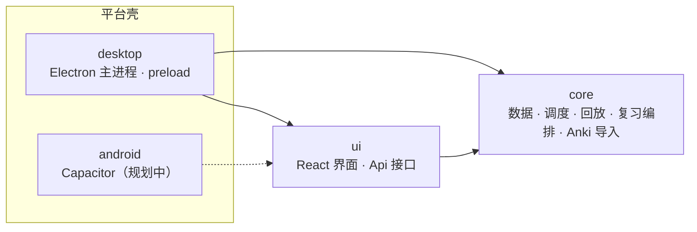

<div align="center">

# Fragmemo

**把零散的词句，记成长久的记忆。**

兼容 Anki 卡包的记忆卡应用 · 为日语和英语学习者设计 · 数据完全属于你

[](LICENSE)


</div>

---

## 为什么是 Fragmemo

背单词的工具很多，但大多数要么把你的数据锁在自己的服务器里，要么十年如一日地只会“翻卡片”。Fragmemo 想做的是另一种样子：

- **你的卡组就是一个文件夹。** 纯文本、可读、可 diff，用 git 记录每一次改动。不想用了，带走的是完整的数据，而不是一个导出按钮。
- **记得越牢，考得越难。** 同一张卡，刚学时做选择题，稳定后听音辨义，再往后翻卡回忆，最后亲手拼写出来。
- **Anki 卡包直接用。** 多年积累的卡包不用转换、不丢样式，导入即可开始复习。

## v0.1 · 本地复习

这是 Fragmemo 的第一个版本，完整实现了 macOS 上的本地复习体验。

### Anki 卡包，原样导入

- 支持新旧两代 `.apkg` / `.colpkg`，包括新版 Anki 导出的 `anki21b` 格式（zstd 压缩、protobuf 媒体表）
- 卡片按原模板渲染：字段、条件区块、`furigana` / `kana` / `kanji`、`cloze`、`hint` 等过滤器，图片与音频一并导入
- 可同时导入 Anki 的复习记录，学习进度无缝延续
- 同一个卡包重复导入只会更新，不会重复；笔记 id 保持不变
- 原模板在沙箱 iframe 中运行，脚本可用，但碰不到应用本身

### 四种作答模式，随记忆强度自动切换

| 模式 | 何时出现 | 判分 |
| --- | --- | --- |
| 选择 | 记忆稳定度 < 3 天 | 自动；干扰项优先取易混词，再取读音、写法最接近的词 |
| 听音 | 3–10 天 | 自评；有录音放录音，没有就用系统语音 |
| 翻卡 | 10–30 天，以及所有 Anki 原模板卡 | 自评 |
| 拼写 | ≥ 30 天 | 自动；日语汉字或假名都算对，英语差一个字母时由你裁定 |

复习时可以临时切换模式，也可以把某张卡固定在某种模式上。阈值可在设置中调整。

### FSRS 调度

基于 [ts-fsrs](https://github.com/open-spaced-repetition/ts-fsrs) 的 FSRS-7 算法，可设置目标记忆率。每日新卡与复习上限按语言统一计算，同一笔记的多个卡面不会在同一天互相“剧透”。

### 安静、键盘优先的界面

浅色、深色、护眼三套主题，可跟随系统。复习全程不用离开键盘：

| 按键 | 作用 |
| --- | --- |
| `Space` / `Enter` | 显示答案 · 继续 |
| `1` – `4` | 选择选项 · 评分（忘记 / 困难 / 良好 / 简单） |
| `R` | 重播读音 |
| `⌘Z` | 撤销上一张 |
| `Esc` | 结束本轮 |
| `⌘,` | 打开设置 |

## 数据就是文件

Fragmemo 的一切都保存在你选择的 Library 文件夹里，它同时是一个 git 仓库：

```
Library/
├── settings.json
├── decks/<deckId>/
│   ├── deck.json                 # 卡组信息
│   ├── notes.jsonl               # 一行一条笔记
│   ├── tpl/<name>/               # Anki 原模板：front.html / back.html / style.css
│   └── media/<sha256>.<ext>      # 媒体按内容寻址，天然去重
└── logs/<deviceId>/<yyyy-mm>.jsonl   # 复习日志，只追加
```

卡片的复习状态不单独存储，而是由日志**回放**得出：同一组日志，无论以什么顺序合并，结果都完全一致。多台设备的记录可以直接合并而不起冲突，任何一次误操作也都能撤销。

每轮复习、每次编辑、每次导入都会自动生成一次提交（`review: 32 cards`、`edit: n3-emotion`、`import: jlpt-n5`），历史清清楚楚。

## 开始使用

当前版本需要从源码运行。

**环境要求**：macOS、Node.js 22+、pnpm、git

```bash
git clone https://github.com/m1inato/Fragmemo.git
cd Fragmemo
pnpm install
pnpm dev
```

首次启动时选择一个空文件夹作为 Library，然后导入一个 Anki 卡包，或者新建卡组手动添加单词、句子和语法。

## 架构



| 包 | 职责 |
| --- | --- |
| `packages/core` | 领域模型与全部业务逻辑。不依赖 Node、DOM 或任何平台 API，文件、git、时钟、id 都通过接口注入，桌面端与移动端共用同一份代码 |
| `packages/ui` | React 界面，只通过一个类型化的 `Api` 接口访问外部 |
| `apps/desktop` | Electron 壳：文件存储、git 同步、媒体协议、IPC，主进程按领域拆成模块 |

设计原则：

1. **文件即数据** —— 卡组是纯文本文件夹，与公开卡包同格式
2. **日志即状态** —— 复习只追加日志，卡片状态由回放得出
3. **单写者** —— 卡片内容只由 Mac 写；每台设备只写自己的日志
4. **内核无平台依赖** —— `core` 不引用 `fs`、`child_process`、DOM
5. **AI 不直接写盘** —— AI 只产出变更集，经检查后才落盘

完整设计见 [docs/architecture.md](docs/architecture.md)。

## 路线图

| 版本 | 内容 | 状态 |
| --- | --- | --- |
| **M1 本地复习** | 卡组读写、FSRS 调度与日志回放、四种作答模式、Anki 卡包与复习记录导入 | ✅ v0.1 |
| **M2 AI** | 用本机 Claude Code / Codex 或 OpenAI 兼容 API 生成卡组、补全释义例句、答疑；所有改动经代码校验、整批可回滚 | 规划中 |
| **M3 同步 + Android** | 通过私有 GitHub 仓库在 Mac 与 Android 间同步，手机端复习与收藏 | 规划中 |
| **M4 卡包仓库** | 公开卡包仓库，应用内浏览、一键安装 | 规划中 |

## 开发

```bash
pnpm test        # 单元测试
pnpm typecheck   # 类型检查
pnpm build       # 构建桌面端
FRAGMEMO_USER_DATA=/tmp/fragmemo-dev pnpm dev   # 使用独立的配置目录，不影响日常使用的 Library
```

## 许可证

[AGPL-3.0](LICENSE)
