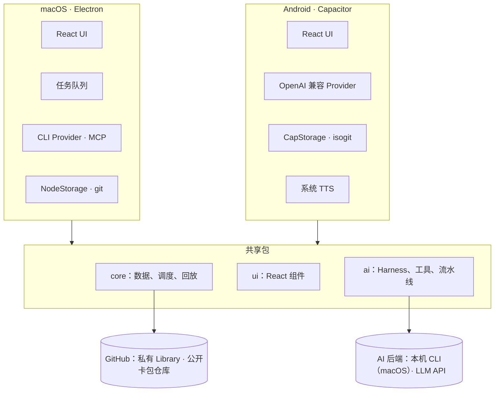

# Fragmemo 架构 v1.0

2026-11-19 · @m1inato

Fragmemo 是兼容 Anki 卡包的记忆卡应用，macOS + Android，全 TypeScript，内置 AI Agent 维护词汇、生成卡组、答疑。

## 概述

| 项 | 内容 |
| --- | --- |
| 平台 | macOS（工作台：编辑、AI 任务、复习）· Android（复习、问答、收藏） |
| 语言 | TypeScript 全栈 |
| 桌面壳 | Electron |
| 移动壳 | Capacitor |
| UI | React，两端共享组件 |
| 调度 | ts-fsrs |
| 同步与历史 | 私有 GitHub 仓库（Mac 系统 git / Android isomorphic-git） |
| AI | 本机 CLI（Claude Code / Codex）或 OpenAI 兼容 API |
| 学习语言 | 日语、英语 |
| 许可证 | AGPL-3.0 |

原则：

1. **文件即数据**：卡组是纯文本文件夹，与公开卡包仓库同格式
2. **日志即状态**：复习只追加日志，卡片状态由回放得出
3. **单写者**：卡片内容只由 Mac 写；每台设备只写自己的日志
4. **内核无平台依赖**：`core` 不引用 `fs`、`child_process`、DOM
5. **AI 不直接写盘**：AI 只产出变更集，由流水线检查后落盘并 commit

## 架构总览



业务逻辑全部在共享包内；平台壳只提供 Storage、SyncBackend、Provider、TtsEngine 的实现。

## 代码结构

```
fragmemo/
├── packages/
│   ├── core/      # 类型、卡组读写、调度、回放、去重、模式选择、复习编排、.apkg / revlog 导入、预设卡包目录
│   ├── ui/        # React 组件、Api 接口定义
│   └── ai/        # Provider、Agent Harness、工具、写入流水线、prompt、任务定义（runJob）、TTS 接口
├── apps/
│   ├── desktop/   # Electron
│   └── android/   # Capacitor
└── pnpm-workspace.yaml
```

| 包 | 依赖 | 运行于 | 平台实现 |
| --- | --- | --- | --- |
| core | ts-fsrs、zod、jszip、sql.js、fzstd、kuromoji | 两端 | — |
| ui | react、core；笔记编辑器 tiptap、katex（按需加载） | 两端 | — |
| ai | core、zod | 两端 | — |
| desktop | electron、系统 git | macOS | NodeStorage、GitCliSync、CliProvider、McpToolServer、TaskQueue、SystemTts |
| android | @capacitor/core、@capacitor/filesystem、isomorphic-git | Android | CapStorage、IsoGitSync、SystemTts |

## 工程风格

整体是“薄壳 + 模块化主进程 + 类型化 bridge + 手写 CSS”的个人桌面应用风格：依赖少、数据是文件、AI 走本机 CLI、界面安静。

**桌面端分层**（electron-vite）

```
apps/desktop/src/
├── main/       # Node：文件、git、CLI 子进程、任务队列、MCP 工具服务
│   ├── index.ts      # 窗口、协议、IPC 注册，只做接线
│   ├── library.ts  review.ts  sync.ts  settings.ts
│   ├── ai.ts  claude.ts  codex.ts  mcp.ts  prompts.ts
│   └── tasks.ts  jobs.ts  tts.ts
├── preload/    # contextBridge 暴露一个类型化的 api 对象，并导出 Api 类型
└── shared/     # 三方共用的纯类型与纯函数
```

renderer 就是 `packages/ui`，只通过 `window.api` 访问一切。`Api` 接口定义在 `packages/ui/src/api.ts`（UI 声明自己需要什么），preload 以 `satisfies Api` 实现并导出该类型。Android 没有主进程：`apps/android/src/api.ts` 在 WebView 内直接实现同一个 `Api` 接口（调 core + Capacitor 插件），UI 代码不区分平台。

**IPC 约定**

| 方向 | 形式 | 示例 |
| --- | --- | --- |
| 请求 | `ipcRenderer.invoke('<域>:<动作>', ...args)` | `decks:list`、`notes:upsert`、`review:answer`、`tasks:act` |
| 推送 | `webContents.send('<域>:changed', payload)` | `tasks:changed`、`library:changed`、`sync:changed` |
| 订阅 | preload 包成 `onXxxChanged(fn) → unsubscribe` | `api.onTasksChanged(setTasks)` |

**后端代码风格**

- TypeScript strict；函数 + 模块，不用 class 和 DI 容器；每个领域模块导出 `initXxx()` 和普通函数，状态放模块级变量
- core 需要跨平台注入，用工厂函数 `createLibrary(deps)`，同样不用 class
- 持久化：每类数据一个 JSON / JSONL 文件；读失败回退默认值；写入 `.tmp` + rename；路径经校验，禁止越出 Library
- 设置：单个 `settings.json`，`getSettings()` 带缓存，`saveSettings(patch)` 合并写入，读取时迁移旧字段；随 Library 同步的设置在 Library 的 `settings.json`，只属于本机的（Library 路径、deviceId、主题）在 userData 的 `settings.json`
- 外部进程：探测路径（配置值 → 常见安装位置 → 登录 shell `command -v`）；给子进程干净环境（去掉 `ANTHROPIC_*`，补 PATH 与系统代理）
- 长任务：`registerRunner(kind, { run, queued, stopped, dropped })`；`run(id, ctx)` 通过 `ctx.report(stage, progress)` 报进度、尊重 `ctx.signal`；失败抛 `TaskError(kind)` 只重试对应阶段
- 错误：对用户只给中文短句加降级行为（如“这个 key 不对，先用系统语音”），不展示堆栈
- 安全：`contextIsolation: true`；媒体走自定义协议 `fragmemo://media/<deckId>/<file>`；外链一律 `shell.openExternal`，窗口内禁止导航
- 开发：`FRAGMEMO_USER_DATA` 指向独立 profile，不碰真实库
- 注释写“为什么”；代码与注释英文，用户可见文案中文
- 不引入：状态管理库、ORM、Agent 框架、UI 组件库

**前端风格**

- React 函数组件 + hooks；状态就近 `useState`，跨页面数据来自 `api` 调用与 `onXxxChanged` 订阅
- 按页面 / 面板拆文件：`App`、`Welcome`、`Home`、`Review`、`DeckView`、`NoteEditor`、`Generate`、`Inbox`、`Tasks`、`SidePanel`（问答）、`SettingsModal`；工具函数放 `lib/`
- 样式：手写 CSS，不用 Tailwind；`styles/base.css` 放设计令牌，每个页面一个 CSS 文件
- 设计令牌（HSL 变量）：`--background --foreground --card --popover --primary --muted --muted-foreground --faint-foreground --accent --border --destructive --radius --shadow --shadow-pop`
- 主题：`light / dark / sepia（护眼）/ system`，通过 `html[data-theme]` 切换；窗口背景色跟随主题，启动无白闪
- 视觉：安静的钢蓝主色；深色模式炭灰分层；`0.5rem` 圆角带细边框的卡片；两层柔和阴影；不用渐变；可选自定义壁纸（模糊 + 主题色蒙层）
- 字体：开源字体经 `@fontsource` 打包（Outfit、Inter、Geist、IBM Plex、Manrope、JetBrains Mono 等），设置里可选也可用任意已安装字体，运行时写入 `--font-ui --font-display --font-mono --font-serif`；中文回退 PingFang SC，日文回退 Hiragino Sans；中文破折号、省略号用 `unicode-range` 单独映射到中文字形
- 窗口：`titleBarStyle: 'hiddenInset'`，红绿灯内嵌，标题区自绘
- 反馈：底部 Toast（可绑定 Promise，完成前不消失）；长任务在任务面板显示阶段与进度
- 文案：中文、口语、简短

## 数据模型

```
Library/                         # 私有 git 仓库根目录
├── settings.json
├── profile.ja.md                # 学习者档案（每语言一份）
├── profile.en.md
├── inbox.jsonl                  # 手机收藏的待处理
├── notebook.json                # 学习笔记（可选）
├── decks/<deckId>/
│   ├── deck.json
│   ├── notes.jsonl              # 一行一条 Note
│   ├── tpl/<name>/              # raw 类型模板：front.html / back.html / style.css（多卡片或 cloze 另有 template.json）
│   ├── notebook.json            # 卡组笔记（可选）
│   └── media/<sha256>.<ext>
├── logs/<deviceId>/<yyyy-mm>.jsonl
├── tasks.json                   # 任务队列
└── tasks/<taskId>.jsonl         # Agent 运行记录
```

**deck.json**

```json
{ "id": "jlpt-n3-emotion", "name": "N3 情绪类形容词", "lang": "ja", "version": 3,
  "tags": ["jlpt", "n3"], "source": "ai", "createdAt": "2026-11-19" }
```

**notes.jsonl**

```json
{"id":"01JD8...","type":"word","key":"ja:嬉しい","fields":{"term":"嬉しい","reading":"うれしい","pos":"い形容词","meaning":"高兴的","examples":[{"text":"合格できて嬉しい。","translation":"能考上很高兴。"}],"confusables":["楽しい"]},"tags":["n3"],"updatedAt":1763520000000,"deleted":false}
```

| type | 必填 | 可选 | 卡面 |
| --- | --- | --- | --- |
| word | term, meaning | reading, pos, examples, notes, audio, confusables | 词→义、义→词 |
| sentence | text, translation | reading, grammar, audio | 句→义、音→句 |
| grammar | pattern, meaning | connection, examples, nuance | 语法→用法、例句填空 |
| raw | 原 .apkg 字段 + template | — | 按原模板 |

规则：

- `id`：ULID；Card id = `<noteId>:<卡面序号>`，不单独存储
- `key`：去重键 = 语言 + 原形（`ja:食べる`）；raw 为 `raw:<anki guid>`
- `mode`（可选）：固定作答模式
- 删除 = `deleted: true`，不物理删除
- raw 模板在 `sandbox="allow-scripts"` 的 iframe 中渲染；raw 转标准类型时保留 `id`
- raw 在列表里显示的标题和释义不写进数据，读取时推断：标题取第一张卡正面出现的、多数笔记非空、取值短且基本不重复、不是纯数字的字段；释义取只在背面出现的同类字段。Anki 的排序字段不可靠（常是编号或词表名），不用
- 媒体文件名 = 内容 sha256

**notebook.json**：笔记面板的内容，tiptap（ProseMirror）文档 JSON；图片目前以 data URL 内嵌，之后改存 `media/`。

**学习者档案**：全局偏好表，每次 AI 调用都注入 system prompt。

```markdown
# 学习档案（日语）
- 母语：中文；释义用中文
- 水平：N4，目标 N3；例句不超过 N3
- 不用罗马音；标注与中文含义不同的汉字词
```

## 复习

作答模式按 FSRS 稳定度自动选择；Note 的 `mode` 优先；复习中可临时切换并选择是否固定。

| 模式 | 默认条件 | 判分 | 适用 |
| --- | --- | --- | --- |
| choice 选择题 | 稳定度 < 3 天 | 自动 | word, grammar, raw* |
| listen 听音辨义 | 3–10 天，有音频或 TTS | 自评 | word, sentence |
| flip 翻卡 | 10–30 天；认不出词头的 raw 始终 | 自评 | 全部 |
| spell 拼写 | ≥ 30 天 | 自动 | word, raw* |

阈值在 settings.json，初始 3 / 10 / 30 天。

\* raw 用推断出的词头和释义出题（干扰项取同模板、词头相近的笔记的释义），揭晓后显示原模板背面；认不出词头的只能翻卡。

每日新卡与复习上限按语言计算（跨卡组共享）；同一 Note 的新卡面每天只出一张（兄弟卡埋藏）。

评分：

- 自动判分答错 → 记 1（忘记）
- 答对 → 用户选 2 / 3 / 4
- 拼写：日语假名或汉字写法均对；英语忽略大小写，编辑距离 1 提示“接近”，由用户裁定

干扰项（取 3 个，依次补足）：`confusables` → 同语言同词性中读音/写法编辑距离最近 → 同卡组随机。

**日志**（`logs/<deviceId>/<yyyy-mm>.jsonl`，只追加）

```json
{"id":"01JD9...","cardId":"01JD8...:0","rating":3,"reviewedAt":1763523600000,"durationMs":4200,"device":"mac-a1b2","mode":"choice","correct":true}
{"id":"01JDA...","type":"undo","target":"01JD9...","reviewedAt":1763523610000,"device":"mac-a1b2"}
```

Anki revlog 导入的条目带 `"imported":"anki"`，id 为 `anki-<revlog id>-<card id>`，重复导入自动去重。

**回放**：读取所有设备日志 → 按 `id` 去重 → 按 `reviewedAt` 排序 → 应用 undo → 逐卡调用 ts-fsrs → 得到卡片状态。结果只缓存在内存（桌面可加 SQLite 缓存），可随时重建。

**词汇掌握度**：由回放结果推算，稳定度 ≥ 30 天为 mastered，其余已学为 learning，供 AI 去重和控制难度。

## 同步与历史

Library 是一个私有 GitHub 仓库，git 同时承担同步、历史和回滚。

| 端 | 实现 | commit 时机 | pull / push |
| --- | --- | --- | --- |
| macOS | 系统 git（`child_process`） | AI 任务完成、手动编辑保存、一轮复习结束 | 启动时 pull；commit 后 push；每 10 分钟 pull |
| Android | isomorphic-git | 一轮复习结束、收藏 | 打开时 pull；commit 后 push |

- 写入范围：Android 只写 `logs/android-*/` 与 `inbox.jsonl`；其余只有 macOS 写
- `.gitattributes`：`inbox.jsonl merge=union`
- commit message：`ai: <taskKind> <摘要> #<taskId>` / `review: <n> cards` / `edit: <deckId>`
- 回滚：整个 AI 任务 = 按任务记录逐条还原（新建的标记 `deleted`，修改的恢复写入前的版本，之后又被改过的保留）并提交 `revert: <kind> #<taskId>`。不用 `git revert`：`notes.jsonl` 相邻行一变就会冲突；单卡历史 = 遍历该 `notes.jsonl` 的历史版本并按 Note id 取行
- 大文件：`media/` 直接入库；仓库过大时迁至 Git LFS
- 同步层接口 `SyncBackend { pull(); commit(msg); push() }`，两端各一个实现

## core 接口

**类型**

```ts
export type Lang = 'ja' | 'en'
export type NoteType = 'word' | 'sentence' | 'grammar' | 'raw'
export type AnswerMode = 'flip' | 'choice' | 'listen' | 'spell'
export type Rating = 1 | 2 | 3 | 4

export interface Example { text: string; translation: string; reading?: string }
export interface WordFields {
  term: string; meaning: string
  reading?: string; pos?: string; examples?: Example[]; notes?: string; audio?: string; confusables?: string[]
}
export interface SentenceFields { text: string; translation: string; reading?: string; grammar?: string[]; audio?: string }
export interface GrammarFields { pattern: string; meaning: string; connection?: string; examples?: Example[]; nuance?: string }
export type RawFields = Record<string, string>

interface NoteBase<T extends NoteType, F> {
  id: string; type: T; key: string; fields: F; tags: string[]
  mode?: AnswerMode; updatedAt: number; deleted: boolean
}
export type Note =
  | NoteBase<'word', WordFields>
  | NoteBase<'sentence', SentenceFields>
  | NoteBase<'grammar', GrammarFields>
  | (NoteBase<'raw', RawFields> & { template: string })

export interface DeckMeta {
  id: string; name: string; lang: Lang; version: number
  tags: string[]; source: 'ai' | 'repo' | 'apkg' | 'manual'; createdAt: string
}

export type LogEntry =
  | { id: string; type?: 'review'; cardId: string; rating: Rating; reviewedAt: number; durationMs: number
      device: string; mode: AnswerMode; correct?: boolean; imported?: 'anki' }
  | { id: string; type: 'undo'; target: string; reviewedAt: number; device: string }

export interface InboxItem { id: string; lang: Lang; text: string; context?: string; createdAt: number; device: string }
```

**平台接口**（路径为相对 Library 根的 POSIX 路径）

```ts
export interface Storage {
  readText(path: string): Promise<string | null>
  writeText(path: string, data: string): Promise<void>     // 原子写：.tmp + rename
  appendText(path: string, data: string): Promise<void>
  list(dir: string): Promise<string[]>
  readBytes(path: string): Promise<Uint8Array | null>
  writeBytes(path: string, data: Uint8Array): Promise<void>
}
export interface SyncBackend { pull(): Promise<void>; commit(message: string): Promise<string | null>; push(): Promise<void> }
export interface Clock { now(): number }
export interface Ids { ulid(): string }
```

**Library**

```ts
export function createLibrary(deps: { storage: Storage; sync: SyncBackend; clock: Clock; ids: Ids; deviceId: string }): Library

export interface Library {
  listDecks(): Promise<DeckMeta[]>
  renameDeck(deckId: string, name: string): Promise<DeckMeta>   // 只改显示名，id 和路径不变
  getNotes(deckId: string): Promise<Note[]>
  noteRows(deckId: string): Promise<NoteRow[]>                  // 列表用：{ note, title, detail }，raw 按上面的规则推断
  upsertNotes(deckId: string, notes: Note[]): Promise<void>
  findByKey(key: string): Promise<{ deckId: string; note: Note } | null>

  dueCards(o: { lang: Lang; deckIds?: string[]; limit: number; newLimit: number }): Promise<DueCard[]>
  pickMode(cardId: string): Promise<AnswerMode>
  distractors(cardId: string, n: number): Promise<string[]>
  review(cardId: string, r: { rating: Rating; mode: AnswerMode; correct?: boolean; durationMs: number }): Promise<void>
  undo(): Promise<void>
  leeches(minLapses: number): Promise<DueCard[]>
  knownTerms(lang: Lang): Promise<{ mastered: string[]; learning: string[] }>

  overview(): Promise<LangSummary[]>                            // 首页：按语言汇总今日待复习 / 新卡
  getCard(cardId: string): Promise<DueCard | null>
  previewIntervals(cardId: string): Promise<Record<Rating, number>>
  today(lang: Lang): Promise<{ reviewed: number; introduced: number }>
  studyActivity(days?: number): Promise<StudyActivity>          // 每天的有效复习数、连续天数、最近学过的词

  addToInbox(item: Omit<InboxItem, 'id' | 'createdAt' | 'device'>): Promise<void>
  importApkg(bytes: Uint8Array, o?: { name?: string }): Promise<ImportResult>  // 生成 raw Note；name 用于新卡组的显示名
  importRevlog(bytes: Uint8Array): Promise<number>              // 按 Anki note guid 对应
  importDeckFolder(files: Map<string, Uint8Array>): Promise<ImportResult>

  reload(): Promise<void>                                       // sync pull 之后重读
  commit(message: string): Promise<string | null>               // 由壳决定何时提交
}

// 复习编排（core/review.ts）：把调度结果变成复习界面要显示的内容，两端共用
export function nextReview(lib: Library, scope: ReviewScope, host: ReviewHost): Promise<ReviewQueue>
export function prepareReview(lib: Library, cardId: string, host: ReviewHost, mode?: AnswerMode): Promise<ReviewItem>

export function createScheduler(fsrs: Settings['fsrs']): Promise<Scheduler>               // ts-fsrs DefaultScheduler
export function replay(logs: LogEntry[], scheduler: Scheduler): Map<string, CardState>    // 纯函数
```

.apkg 解析：jszip 解包 → sql.js 读 `collection.anki21`（`anki21b` 先 zstd 解压）。

**预设卡包**：`core/presets.ts` 是目录（名称、语言、简介、大小、sha256、下载地址），只是数据。卡包文件放在本仓库的 GitHub Release（`presets-N`，当前 `presets-2`；旧的保留给旧版本），不进仓库、不进安装包。壳在用户点击时下载到应用缓存目录（不在 Library 里，不进 git），校验 sha256 后按普通 .apkg 导入，卡组名取目录里的名称。更换卡包 = 发新的 Release 并改目录。

## AI 层

**Provider**

```ts
export type Provider = ApiProvider | CliProvider

// 聊天 API：harness 跑工具循环，每次 step 一轮
export interface ApiProvider {
  kind: 'api'; id: 'openai-compatible'; available(): Promise<boolean>
  step(req: { system: string; messages: Msg[]; tools?: ToolSpec[]; signal: AbortSignal },
       onText?: (delta: string) => void): Promise<AssistantTurn>
}

// 本机 Agent CLI：自己跑工具循环，经 MCP 回调 call；session 延续上一次对话
export interface CliProvider {
  kind: 'cli'; id: 'claude-cli' | 'codex-cli'; available(): Promise<boolean>
  run(req: { system: string; prompt: string; session?: string; tools: ToolSpec[]
             call(name: string, input: unknown): Promise<{ output: string; error?: boolean }>
             maxSteps: number; signal: AbortSignal; onEvent?: (e: AgentEvent) => void }): Promise<{ text: string; session?: string }>
}
```

| 实现 | 平台 | 说明 |
| --- | --- | --- |
| ClaudeCliProvider | macOS | 启动本机已登录的 `claude` 子进程，stream-json 输出；禁用内置工具，只接入 Fragmemo 的 MCP 工具；清除环境中的 `ANTHROPIC_*` 变量；可通过 Anthropic 兼容接口指向 DeepSeek |
| CodexCliProvider | macOS | 启动本机已登录的 `codex app-server`（JSON-RPC），Fragmemo 的工具以 dynamic tools 注入，关闭 shell、插件和联网搜索；不能续接会话，问答的历史由 harness 拼进 prompt（`resumable: false`） |
| OpenAICompatProvider | 两端 | base URL + key + model；key 只存本机 |

CLI 参数集中在 `apps/desktop/src/main/cli-args.ts`，以当前版本 `--help` 为准；prompt 经 stdin 传入。用途分“生成与修改”（所有写入任务，修正轮在同一会话内进行，必须同一 Provider）和“问答”，各自可选 Provider 和模型。DeepSeek 走 ClaudeCliProvider，把 Anthropic 兼容地址和 key 交给 `claude`。

**Agent Harness**

```ts
export interface Tool<I, O> {
  name: string; description: string
  input: z.ZodType<I>
  run(input: I, ctx: ToolCtx): Promise<O>
}
export interface ToolCtx {
  library: Library; analyzer: Analyzer; lang: Lang
  deckId?: string                 // 新建笔记放进哪个卡组
  changes: ChangeSet; ids: Ids; signal: AbortSignal
}

export function runAgent(o: {
  provider: Provider; system: string; prompt: string; tools: Tool<any, any>[]
  maxSteps?: number            // 默认 12
  signal: AbortSignal; onEvent?: (e: AgentEvent) => void
  history?: Msg[]; session?: string   // 延续上一轮（API 用 transcript，CLI 用 session）
}): Promise<{ text: string; changes: ChangeSet; session?: string; transcript: Msg[] }>
```

- API Provider：harness 自己循环，模型不再调工具或达到 `maxSteps` 时结束
- CLI Provider：CLI 自身循环；同一套 `Tool` 由主进程内的 MCP 服务暴露（Streamable HTTP，只绑 127.0.0.1，每次运行一个随机 bearer token），工具在 Electron 主进程内执行。用 HTTP 而不是 stdio，省掉一个转发进程。CLI 的内置工具全部禁用（`--tools ""` + `--strict-mcp-config`），步数在 MCP 一侧计数限制
- 运行记录写入 `tasks/<taskId>.jsonl`

| 工具 | 读写 | 作用 |
| --- | --- | --- |
| `search_notes` | 读 | 按词、标签、卡组查询 |
| `get_leeches` | 读 | 高遗忘卡及其复习记录 |
| `known_terms` | 读 | mastered / learning 词表 |
| `analyze_text` | 读 | 分词、读音、原形 |
| `read_inbox` | 读 | 待处理收藏 |
| `propose_notes` | 写 | 新建 / 修改 Note，写入 `ChangeSet` |

无删除工具。问答只挂读工具；回答上的“加入卡组”触发一次带 `propose_notes` 的运行。

**写入流水线**（所有 AI 写操作共用）

1. `runAgent` 产出 `ChangeSet`
2. 代码检查，生成问题清单：schema 校验；读音与分词结果一致；例句包含该词（按原形）；与已有 `key` 不重复；例句中超出目标等级的词须在 known\_terms 内（待定：需要分级词表，尚未实现）
3. 清单非空 → 在同一会话中交回模型：逐条给出问题与代码依据，要求只通过 `propose_notes` 修改并回复改动的 id，无改动回复 `NONE`
4. 第 2–3 步最多 2 轮
5. 通过的变更写入 `notes.jsonl` → `sync.commit()`；未通过的进入“待确认”（在任务面板逐条加入或丢弃）；删除类变更始终进入“待确认”
6. 每条写入都记下写入前的版本（`tasks/<taskId>.applied.json`），供整批撤销

**任务队列**（macOS）

单队列串行；状态持久化在 `tasks.json`，重启后续跑；可暂停、取消、重试、整批撤销；任务上报阶段与进度。中途失败时已写入的批次照常提交，仍可撤销。Android 只能入队（`queued`），由 macOS 同步后执行。

任务本身是 `packages/ai` 里的纯函数 `runJob(input, deps)`；队列、持久化与提交在 `apps/desktop/src/main/tasks.ts`、`jobs.ts`。

| kind | 输入 | 工具 |
| --- | --- | --- |
| generate-deck | 自然语言需求 + 数量 | 全部 |
| extract-from-text | 文章 / 歌词 | 全部 |
| enrich-notes | noteId 列表 + 字段 | 全部 |
| convert-raw | raw 卡组 | 全部 |
| process-inbox | inbox | 全部 |
| leech-helper | 高遗忘卡 | 全部 |
| tts | 文本列表 | —（M3，随 TTS 引擎一起） |

**生成约束**：system prompt = 角色 + 对应语言的学习者档案 + 规则（term 用原形、例句不超等级、不确定则留空）；`propose_notes` 的输入 schema 即 Note 字段 schema；大批量分批，每批 10–15 条。

**TTS**

```ts
export interface TtsEngine {
  id: string                                                  // 'system' | 'fish' | ...
  checkKey?(key: string): Promise<string | undefined>         // 免费接口验证，返回错误文案
  speak(text: string, o: TtsOpts): Promise<void>
  synthesize?(text: string, o: TtsOpts): Promise<{ audio: Uint8Array; type: string } | undefined>
}
export interface TtsOpts { lang: Lang; voice?: string }
```

- 合成失败不抛错：返回 `undefined` 并发出提示，调用方降级到 `system`
- `system`：macOS Web Speech API，Android Capacitor TTS
- `fish`：Fish Audio `/v1/tts`（`reference_id` 为音色，mp3）
- 每种语言独立配置引擎与音色
- `synthesize` 结果存 `media/<sha256>.mp3` 并写入 `audio` 字段；播放优先用 `audio`

## 里程碑

| 里程碑 | 范围 | 完成标准 |
| --- | --- | --- |
| M1 本地复习 | monorepo、core 类型、NodeStorage、日志与 `replay`、四种作答模式、.apkg / revlog 导入 | `replay` 顺序无关性测试通过；导入真实 JLPT 卡包并连续使用 7 天 |
| M2 AI | Provider（ClaudeCli、OpenAICompat）、Agent Harness、MCP 工具服务、写入流水线、任务队列、问答 | 生成 3 套卡组并人工抽检；可整批撤销 |
| M3 同步 + Android | GitCliSync、IsoGitSync、Capacitor 壳、CapStorage、TTS、复习提醒 | 两端交替复习 7 天无冲突 |
| M4 卡包仓库 | 公开 GitHub 仓库、`index.json`、应用内浏览下载、.apkg 转换脚本 | 从仓库安装卡包并复习 |

待定：`phrase`（短语/搭配）类型是否进入 M2。
